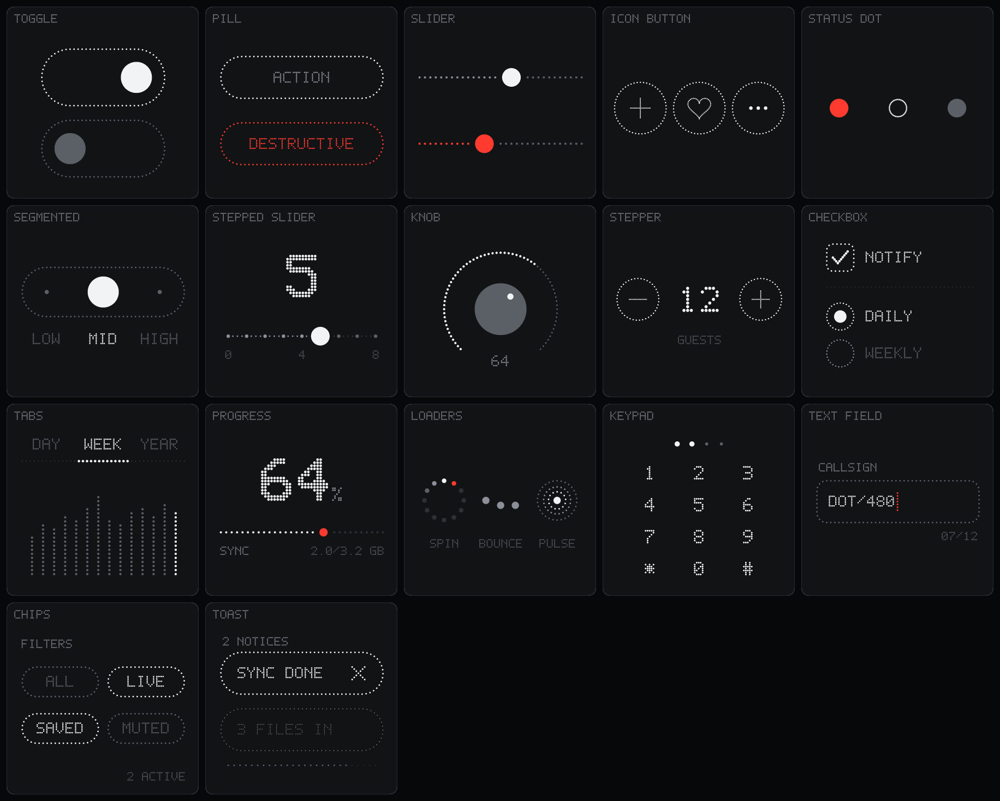
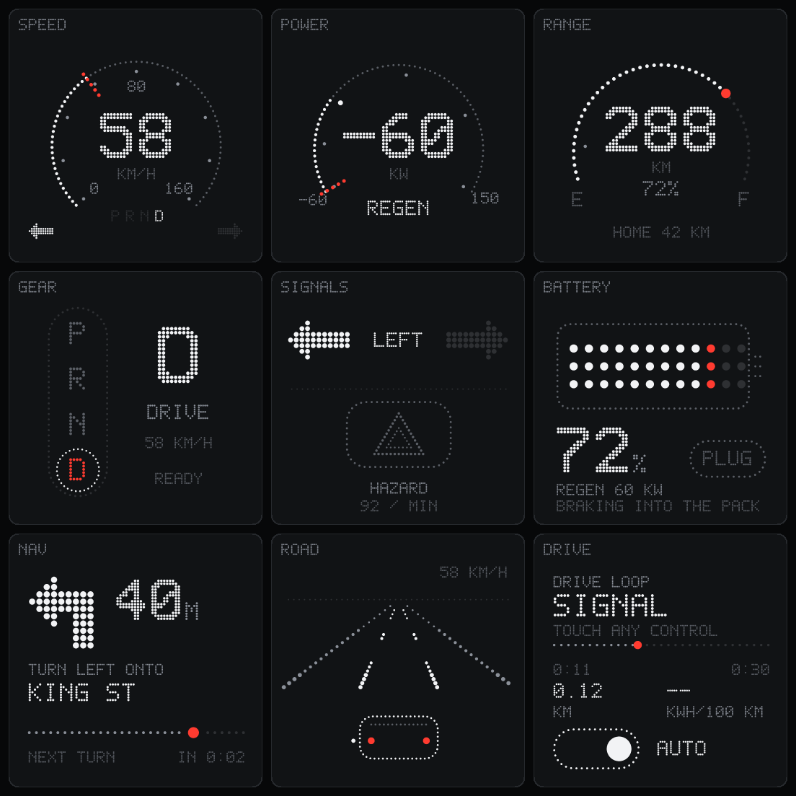
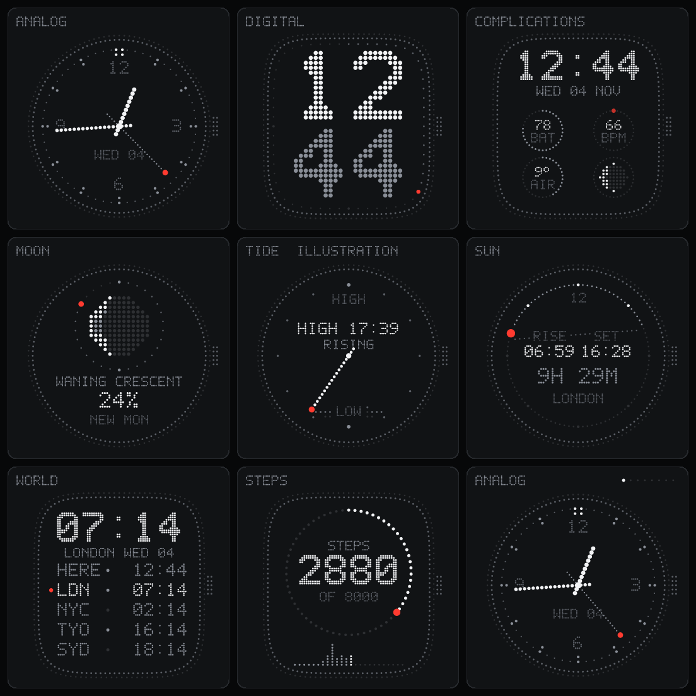
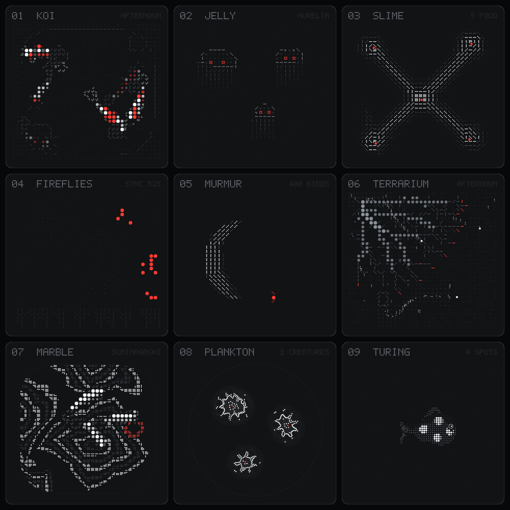

# Matrix

A website where every interface is drawn in dots: clocks, dashboards, games, photos and type, all rendered live on a dot grid.

**Live:** https://matrix.reactopia.me

This is a personal project. It's a website to look at and play with, not a package you install.

| | |
|---|---|
|  |  |
|  |  |

## What you can do there
- **Browse about 40 boards** of cards: UI kits, car instruments, watch faces, live weather and GitHub data, charts, physics toys, a synth, a game, camera halftone, simulations and GPU light.
- **Make your own** in MAKE: tune a preset and export it, compose a card from layers, write a small field program and share it as a link, or paint dots by hand.
- **Change the look** of everything at once: light or dark, seven accents or any hue, and display skins like CRT, VFD, LED, e-ink, flip-disc and Nixie.
- **Save any card** as PNG or SVG, copy a link to it, or open it on its own page.
- **Read how it works** in the blog: the essay "Ditherpunk for UI" and three tutorials with live cards and code.

## Run it locally
You need Node 22 and pnpm.

```bash
pnpm install
pnpm dev        # dev server at http://localhost:5173
pnpm check      # typecheck, lint and the acceptance checks
```

Other useful scripts:

```bash
pnpm build                   # production build into dist/ (plus OG images and per-board pages)
pnpm golden --check          # every card still matches its pinned pixels in goldens/
pnpm snap --board components # a headless PNG of a board (or card ids) into .snapshots/
```

## How the engine works
Every card is a list of fields. A field is a function that says how bright each point is.
A grid sampler reads the fields onto a quantized grid of dots, and a renderer draws them with SVG, Canvas or WebGL2.
The engine (codename Dot/480) is plain TypeScript with no framework and no dependencies. Tokens and components are in [DESIGN.md](DESIGN.md), the modules and algorithms in [docs/DOT-MATRIX-ENGINE-PLAN.md](docs/DOT-MATRIX-ENGINE-PLAN.md).

## Links into the site
- `/<board>/` opens a board, for example `/light/` or `/components/`.
- `/widget/<card>/` opens one card on its own page.
- `?make=tune|compose|code|draw` opens MAKE in that mode, and `?about` opens ABOUT.
- `?skin=crt` picks a display skin, and `?pro=1` opens every fold.
- `?theme=light_cobalt` (or `?scheme=` and `?accent=`) shows a theme for the visit without saving it.

Old links keep working: renamed boards resolve through `boardAliases` in `src/widgets/manifest.ts`.

## Layout of the repo
| Path | What |
|---|---|
| `src/engine/` | The engine: fields, sampler, renderers, layout, motion, Field IR, light, simulations, halftone, display skins. No framework, no dependencies. |
| `src/widgets/` | The cards (`boards/<board>.ts`), the board manifest and the card descriptions |
| `src/components/` | The React app: boards, the picker, MAKE (tune, compose, code, draw), the palette and the skins |
| `src/site/`, `src/data/`, `src/blog/`, `src/essay/` | Page meta and URLs, themes, live data sources, the blog and the essay |
| `scripts/` | Checks, goldens, snapshots, the size budget, the post-build step and the headless browser probes |
| `packages/`, `registry/`, `mcp/`, `targets/` | Kept but not published: the core, element and React packages, a shadcn registry, an MCP app and device senders |

## Writing a card
```ts
import { TILE, layer, layoutFor, tileStyle, type WidgetPreset } from '../types'

const T = layoutFor(TILE)
export const myTimer: WidgetPreset = {
  id: 'my-timer', name: 'Timer', label: '01  TIMER', group: 'polar', chrome: 'dots', grid: TILE, style: tileStyle,
  defaults: { progress: .62 },
  layers: ({ data }) => [
    layer(T.dotRing(72, 78, 46, { spacing: 4, size: 2 }), 'idle'),
    layer(T.dotRing(72, 78, 46, { spacing: 4, size: 2, sweep: Math.PI * 2 * data.progress }), 'active'),
    layer(T.big('12:48', 72, 70, { lattice: 2, align: 'center' })),
  ],
}
```
Cards are 144×144 dots. Text goes through `T.text` or `T.big` so glyphs land on whole dots, bigger elements use a coarser `lattice`, and `'active'` is the one accent colour, used for one element per card. To add a board, add it to `src/widgets/manifest.ts` and `src/widgets/index.ts` and give it a description in `src/widgets/blurbs.ts`.

## Docs
- [DESIGN.md](DESIGN.md): tokens, colours, type and components.
- [docs/DOT-MATRIX-ENGINE-PLAN.md](docs/DOT-MATRIX-ENGINE-PLAN.md): the engine's modules and algorithms.
- [docs/README.md](docs/README.md): every other doc, and which ones are current.
- [CHANGELOG.md](CHANGELOG.md): the history.
- [AGENTS.md](AGENTS.md): notes for coding agents.

## Contributing
See [CONTRIBUTING.md](CONTRIBUTING.md).

## Security
To report a security problem, see [SECURITY.md](SECURITY.md).

## License
The code is under the MIT license: see [LICENSE](LICENSE). Parts that come from other projects keep their own licenses, listed in [THIRD-PARTY-NOTICES.md](THIRD-PARTY-NOTICES.md).
