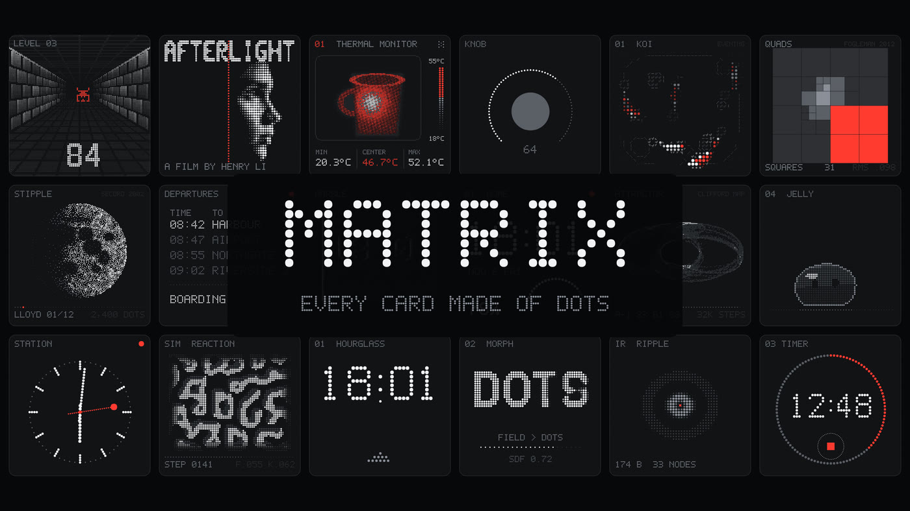
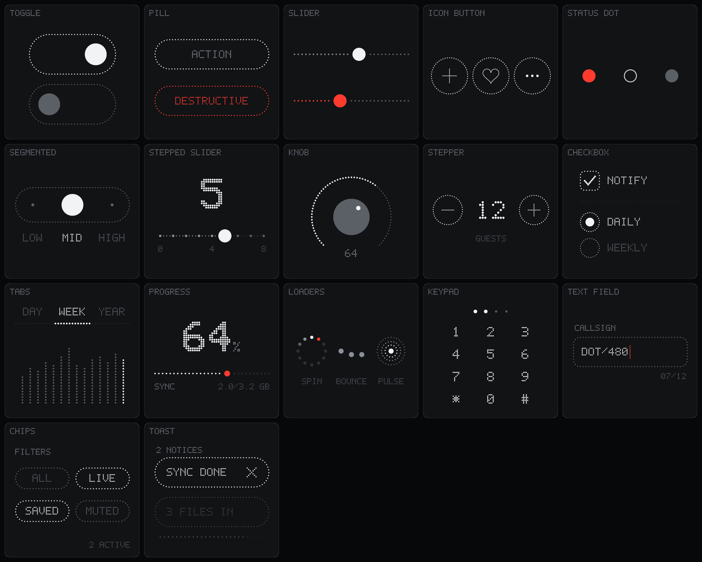
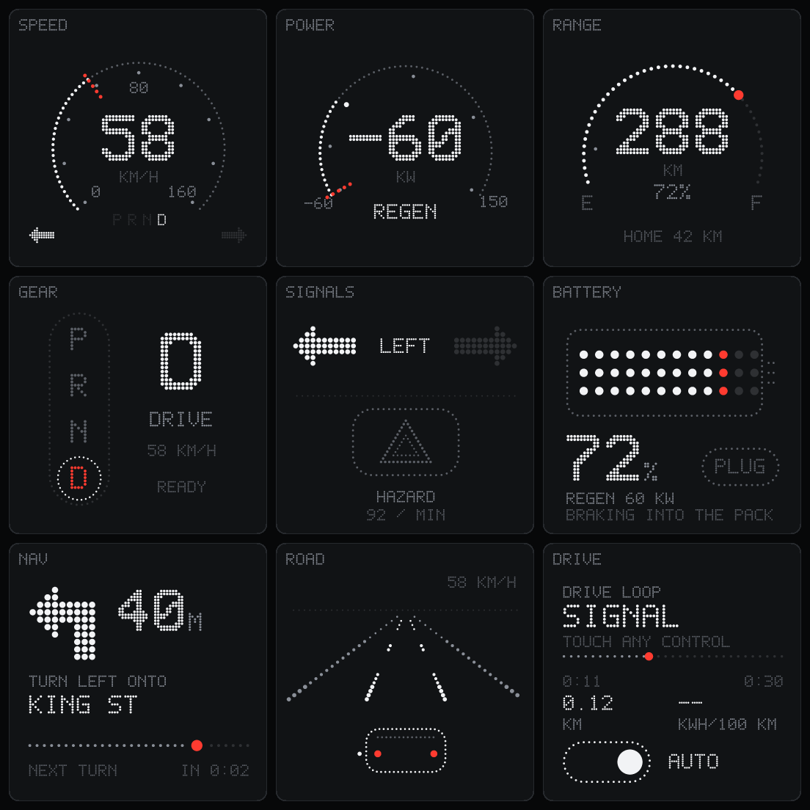
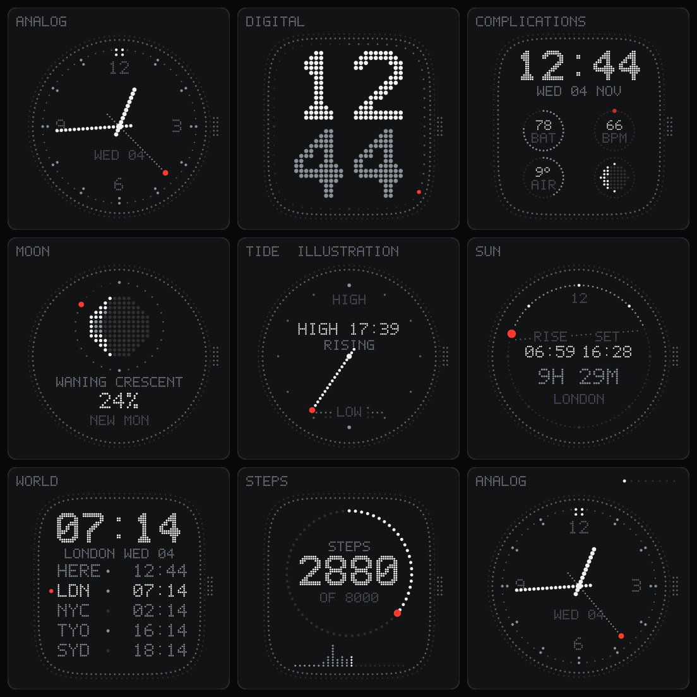
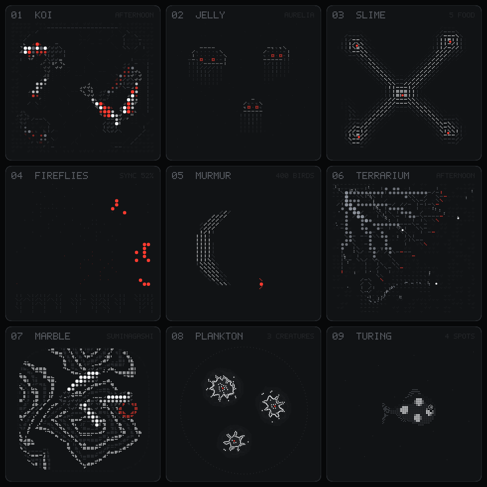
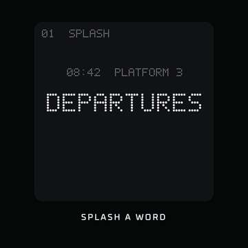
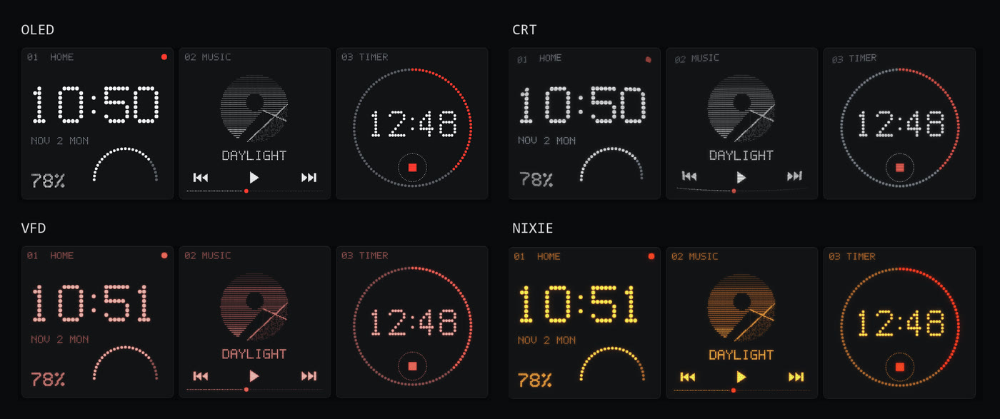
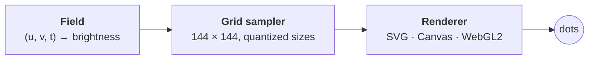

<p align="center">
  <a href="https://matrix.reactopia.me"></a>
</p>

<h1 align="center">Matrix</h1>

<p align="center">
  <b>Interfaces drawn one dot at a time.</b><br>
  Clocks, dashboards, games, photos and type, all sampled live onto a 144 × 144 grid of dots.
</p>

<p align="center">
  <a href="https://matrix.reactopia.me"></a>
  
  
  
  <a href="LICENSE"></a>
</p>

<p align="center">
  <a href="https://matrix.reactopia.me"><b>Open the site</b></a> ·
  <a href="https://matrix.reactopia.me/blog/dot-matrix-essay/">Read the essay</a> ·
  <a href="https://matrix.reactopia.me/blog/build-your-own-dot-engine/">Build your own</a> ·
  <a href="docs/REGISTRY.md">Use the components</a>
</p>

---

It started as one dot on a weekend. Then a clock, then a weather card, then a corridor game with an invader at the end of it. Now it's a website of dozens of boards and hundreds of cards, and every pixel on every one of them is a dot on the same grid.

Nothing is an image pasted in. Each card is a stack of maths that says how bright each point should be, and the engine samples that onto dots, live, in your browser.

## What's in there

| | |
|---|---|
|  |  |
| **UI kits.** Buttons, sliders, knobs, tabs and fields that you can actually press. | **Instruments.** Speedometers, EV gauges, departure boards and live data. |
|  |  |
| **Faces and type.** Watch faces, big dot glyphs and a film poster made of halftone. | **Living scenes.** Koi that swim for hours, ripples, frost, reaction-diffusion. |

Also on the site: physics toys, a synth, a game, camera halftone, old graphics algorithms (stippling, strange attractors, wave function collapse), simulations and GPU light.

### Touch it

The physics cards react to your cursor. Splash a word off a departures board, stir ink, grab a cloth flag. The pond ripples where you touch it.

<p align="center">
  
</p>

### Change the screen

One setting changes the display every card is drawn on. The same field, sampled the same way, then lit like a different kind of hardware.

<p align="center">
  
</p>

Light or dark, seven accents or any hue, and four display skins: OLED, CRT (phosphor, scanlines, curved glass), VFD (fluorescent glow behind a mesh) and Nixie (warm neon behind an anode grid). Any card saves as PNG or SVG, or opens on its own page.

## How it works

Every visual goes through the same three steps. There is no other way to draw.



1. **Field.** A function that returns how bright the point `(u, v)` is at time `t`. SDF shapes, noise, text, photos, simulations and light are all fields, and fields stack in layers.
2. **Sampler.** Reads the layers onto a grid of dots and snaps each dot to a fixed set of sizes, so a whole board shares one visual rhythm.
3. **Renderer.** Draws the dots with SVG, Canvas or WebGL2. Which one is picked by dot count, motion and whether a layer needs the GPU, never by convenience.

The engine (codename Dot/480) is plain TypeScript and browser APIs. No framework, no npm packages, nothing to install.

Cards can also be written as small formulas in a tiny language of their own, and a link to the card carries the whole program. Try the [ripple card](https://matrix.reactopia.me/widget/ir-ripple/), or read [A tiny language for dots](https://matrix.reactopia.me/blog/a-tiny-language-for-dots/) to build the parser yourself.

## Run it locally

You need Node 22 and pnpm.

```bash
pnpm install
pnpm dev        # dev server at http://localhost:5173
pnpm check      # typecheck, lint and the acceptance checks
```

MAKE (the card editor), the Lab and X-ray are behind release flags and off by default. To turn them on in one browser, run this in the DevTools console and reload:

```js
localStorage.setItem('dot480:flags', JSON.stringify({ make: true, lab: true, xray: true }))
```

Flags are never read from the URL. The flag table is in [docs/DEPLOY.md](docs/DEPLOY.md).

<details>
<summary><b>More scripts</b></summary>

```bash
pnpm build                   # production build into dist/ (plus OG images and per-board pages)
pnpm golden --check          # every card still matches its pinned pixels in goldens/
pnpm snap --board components # a headless PNG of a board (or card ids) into .snapshots/
pnpm react-doctor            # React Doctor: a score and React findings (pinned version, settings in doctor.config.ts)
```

`pnpm react-doctor` sends its findings (rule, file and line, no source) to react.doctor for the score. Add `--no-telemetry` to keep a run local. CI runs it as a report next to the gate; it never fails the build.

</details>

## Write a card

```ts
import { TILE, layer, layoutFor, tileStyle, type WidgetPreset } from '../types'

const T = layoutFor(TILE)
export const myTimer: WidgetPreset = {
  id: 'my-timer', name: 'Timer', label: '01  TIMER', group: 'polar', chrome: 'dots', grid: TILE, style: tileStyle,
  defaults: { progress: .62 },
  layers: ({ data }) => [
    layer(T.dotRing(72, 78, 46, { spacing: 4, size: 2 }), 'idle'),
    layer(T.dotRing(72, 78, 46, { spacing: 4, size: 2, sweep: Math.PI * 2 * data.progress }), 'active'),
    layer(T.big('12:48', 72, 70, { lattice: 2, align: 'center' })),
  ],
}
```

A few rules keep every card looking like it belongs:

- **144 × 144 dots** per card. Text goes through `T.text` or `T.big` so glyphs land on whole dots.
- **Bigger things use a coarser lattice**, never clumps of small dots.
- **One accent colour per board.** `'active'` is that colour, used for one element per card.

To add a board, add it to `src/widgets/manifest.ts` and `src/widgets/index.ts` and describe it in `src/widgets/blurbs.ts`. Then check it with `pnpm snap`.

## Use the components in your app

Cards install into any React project with the shadcn CLI, next to the reactopia registry with no name or file clashes:

```sh
pnpm dlx shadcn@latest add https://matrix.reactopia.me/r/matrix-home-clock.json
```

See [docs/REGISTRY.md](docs/REGISTRY.md) for the `components.json` setup, every item and its props.

<details>
<summary><b>Links into the site</b></summary>

- `/<board>/` opens a board, for example [`/components/`](https://matrix.reactopia.me/components/) or [`/physics/`](https://matrix.reactopia.me/physics/).
- `/widget/<card>/` opens one card on its own page.
- `/` shows every card; `?tag=<tag>` and `?q=<words>` filter it. The old `/browse/` redirects there.
- `/about/` opens ABOUT (the old `?about` redirects there).
- `?skin=crt` picks a display skin, and `?pro=1` opens every fold.
- `?theme=light_cobalt` (or `?scheme=` and `?accent=`) shows a theme for the visit without saving it.

Old links keep working: renamed boards resolve through `boardAliases` in `src/widgets/manifest.ts`.

</details>

<details>
<summary><b>Layout of the repo</b></summary>

| Path | What |
|---|---|
| `src/engine/` | The engine: fields, sampler, renderers, layout, motion, Field IR, light, simulations, halftone, display skins. No framework, no dependencies. |
| `src/widgets/` | The cards (`boards/<board>.ts`), the board manifest and the card descriptions |
| `src/components/` | The React app: boards, ALL (every card), the picker, the MAKE editor, the palette, the shell and the skins |
| `src/site/`, `src/data/`, `src/blog/`, `src/essay/` | Page meta and URLs, themes, live data sources, the blog and the essay |
| `api/` | Vercel Functions for likes (`docs/DEPLOY.md` › Likes) |
| `scripts/` | Checks, goldens, snapshots, the size budget, the post-build step and the headless browser probes |
| `registry.json`, `registry/` | The shadcn registry served at `/r/`: card components for other React projects ([docs/REGISTRY.md](docs/REGISTRY.md)) |
| `packages/`, `mcp/`, `targets/` | Kept but not published: the core, element and React packages, an MCP app and device senders |

</details>

## Read more

| | |
|---|---|
| [Ditherpunk for UI](https://matrix.reactopia.me/blog/dot-matrix-essay/) | The essay: how fields turn into dots, with every figure running live |
| [Build your own dot engine](https://matrix.reactopia.me/blog/build-your-own-dot-engine/) | Write a field, a sampler and a canvas renderer, then a dot clock |
| [Living matter](https://matrix.reactopia.me/blog/living-matter/) | Ripples, swimming koi and lit materials that run for hours |
| [DESIGN.md](DESIGN.md) | Tokens, colours, type and components |
| [docs/DOT-MATRIX-ENGINE-PLAN.md](docs/DOT-MATRIX-ENGINE-PLAN.md) | The engine's modules and algorithms |
| [docs/README.md](docs/README.md) | Every other doc, and which ones are current |
| [CHANGELOG.md](CHANGELOG.md) · [AGENTS.md](AGENTS.md) | The history, and notes for coding agents |

## Credits

The project started from Henry Li's ([@henry19840301](https://x.com/henry19840301)) ESP-Mosaico concept screens for a 480 × 480 OLED device, posted on X on 20 Aug 2026 ([first post](https://x.com/henry19840301/status/2090273665669874050), [second post](https://x.com/henry19840301/status/2090454612126146948)). The first seven boards rebuild his sheets, and the 480 in Dot/480 comes from his device.

The koi pond was inspired by Dao Ho's ([daoho.dev](https://www.daoho.dev/)) pond. Every other credit is in [docs/CREDITS.md](docs/CREDITS.md).

## Contributing, security, license

- How to set up, test and send a change: [CONTRIBUTING.md](CONTRIBUTING.md). Code of conduct: [CODE_OF_CONDUCT.md](CODE_OF_CONDUCT.md).
- To report a security problem: [SECURITY.md](SECURITY.md).
- The code is MIT ([LICENSE](LICENSE)). Parts that come from other projects keep their own licenses, listed in [THIRD-PARTY-NOTICES.md](THIRD-PARTY-NOTICES.md).

<p align="center"><sub>A personal project, built in free time. Made of dots all the way down.</sub></p>
